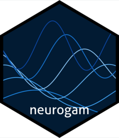

# neurogam: Bayesian modelling of time-resolved electrophysiological data <a href="https://lnalborczyk.github.io/neurogam/"></a>

<!-- badges: start -->

[](https://www.repostatus.org/#wip)
[](https://github.com/lnalborczyk/neurogam)
[](https://github.com/lnalborczyk/neurogam)
<!-- badges: end -->

`neurogam` provides tools to analyse time-resolved effects with
**Bayesian generalised additive multilevel models** (BGAMMs). Built on
[`brms`](https://github.com/paul-buerkner/brms), it combines smooth
estimation of temporal dynamics, posterior inference, and detection and
visualisation of connected regions exceeding a posterior-odds threshold.

The package supports three types of analysis:

| Analysis | Typical applications | Coordinates used for clustering |
|:---|:---|:---|
| **Temporal (1D)** | M/EEG time courses, pupillometry, representational similarity analysis (RSA), decoding accuracy, movement trajectories | Time |
| **Temporal generalisation (2D)** | Cross-temporal decoding or representational-generalisation matrices | Training time x testing time |
| **Spatiotemporal (3D)** | Sensor-level M/EEG smooths over projected sensor position and time | Sensor adjacency x time |

## Installation

Install the development version from GitHub:

``` r
install.packages("pak")
pak::pkg_install("lnalborczyk/neurogam")
```

## Quick start: temporal (1D) analysis

The bundled `eeg_data` dataset illustrates the long-format input
expected by `testing_through_time()`. Each row represents an observation
at a particular time, with participant identifiers and relevant
predictors.

``` r
data(eeg_data, package = "neurogam")
head(eeg_data)
#>      participant condition trial  time       eeg
#> 1 participant_01     cond1     1 0.000 0.8618045
#> 2 participant_01     cond1     1 0.002 1.2729148
#> 3 participant_01     cond1     1 0.004 1.6538158
#> 4 participant_01     cond1     1 0.006 1.3910888
#> 5 participant_01     cond1     1 0.008 0.6499553
#> 6 participant_01     cond1     1 0.010 0.1548358
```

### Fit a Bayesian GAMM

The following one-sample analysis tests whether the time-resolved
outcome differs from its null reference. Setting `predictor_id = NA`
selects the one-sample analysis; use a binary predictor name (e.g.,
`"condition"`) to analyse a two-condition contrast.

We generally recommend starting with `multilevel = "summary"`, which
retains participant-level information while avoiding the cost of a
trial-by-trial multilevel fit. An aggregate group-only model
(`multilevel = "group"`) is also available, but it does not represent
between-participant variability in the same way.

``` r
results_1d <- testing_through_time(
    data = eeg_data,
    participant_id = "participant",
    outcome_id = "eeg",
    time_id = "time",
    predictor_id = NA,
    multilevel = "summary",
    threshold = 10,
    iter = 5000
    )

# Optional: save the result so subsequent analyses need no refitting.
saveRDS(results_1d, "neurogam_results_1d.rds")
```

### Inspect and visualise results

``` r
# Summarise the results
print(results_1d)
summary(results_1d)

# Visualise the results
plot(results_1d)
plot(results_1d, type = "predictions")
plot(results_1d, type = "clusters")
```

### Posterior predictive checks

Posterior predictive checks (PPCs) are important for evaluating model
adequacy. `neurogam` provides a convenient `ppc()` method;
`brms::pp_check()` provides additional options.

``` r
ppc(object = results_1d, ppc_type = "participant")
brms::pp_check(results_1d$model)
```

See the [`bayesplot` PPC
reference](https://mc-stan.org/bayesplot/reference/PPC-overview.html)
for further diagnostics.

### Reuse an existing fit

`previous_model` lets you recompute predictions and cluster detection
without refitting the same model, for example to examine sensitivity to
the posterior-odds threshold. Keep the data, predictor specification,
and model structure compatible with the original fit.

``` r
results_1d_stricter <- testing_through_time(
    data = eeg_data,
    previous_model = results_1d$model,
    participant_id = "participant",
    outcome_id = "eeg",
    time_id = "time",
    predictor_id = NA,
    multilevel = "summary",
    threshold = 20
    )

plot(results_1d_stricter, type = "clusters")
```

## Cross-temporal generalisation (2D)

For modelling a temporal-generalisation matrix, supply **two temporal
coordinates** using `time_id`. A typical long-format dataset has one row
per participant, training time, and testing time (and, if applicable,
condition or other predictor).

``` r
# Illustrative input: `ctg_data` must contain participant, time1,
# time2, accuracy, and any predictor columns used in the model.
results_2d <- testing_through_time(
    data = ctg_data,
    participant_id = "participant",
    outcome_id = "accuracy",
    time_id = c("time1", "time2"),
    predictor_id = NA,
    chance_level = 0.5,
    multilevel = "summary",
    threshold = 10
    )

summary(results_2d)
plot(results_2d)                         # legacy composite plot
plot(results_2d, type = "predictions")   # posterior heatmap
plot(results_2d, type = "clusters")      # cluster membership map
```

The 2D smooth is fitted over both temporal coordinates. The standardised
result view exposes `cluster_summary` and `cluster_membership` in the
same way as for 1D data, with locations identified by their two time
coordinates.

## Spatio-temporal sensor-by-time modelling (3D)

For sensor-level M/EEG, `neurogam` can model responses over **two
projected sensor coordinates plus time**. Unlike a regular
three-dimensional voxel grid, connected clusters are defined over the
actual sensors and their adjacency graph, together with temporal
neighbours. Interpolated scalp images are used for display only.

The long-format input should contain a participant identifier, sensor
identifier, time, observed outcome, and two projected sensor positions
(for example, `xproj` and `yproj`). The same sensor should have
consistent spatial coordinates throughout the analysis.

``` r
# Illustrative input: `eeg_st` contains subject, channel, time,
# xproj, yproj, voltage, and any predictors used by the model.
results_st <- testing_through_time(
    data = eeg_st,
    participant_id = "subject",
    outcome_id = "voltage",
    time_id = "time",
    sensor_id = "channel",
    space_id = c("xproj", "yproj"),
    predictor_id = NA,
    multilevel = "summary",
    threshold = 10,
    threshold_type = "above",
    adjacency_k = 4L
    )

print(results_st)
summary(results_st)

view_st <- as_neurogam_result_view(results_st)
view_st$cluster_summary
neurogam_result_metadata(results_st)$adjacency_source
```

When no sensor adjacency is supplied, the package can construct an
approximate graph from projected positions. For confirmatory
applications, supplying a well-justified montage-specific adjacency
graph is preferable.

### Spatiotemporal visualisation

The unified plotting API delegates to specialized functions. Because
scalp maps and sensor trajectories compare model predictions with
observed data, **3D plots require the original observations** through
`observed_data`.

``` r
# Observed, predicted, and residual scalp maps.
plot(
    results_st,
    type = "topography",
    observed_data = eeg_st,
    outcome_id = "voltage",
    sensor_id = "channel",
    participant_id = "subject",
    n_times = 6L
    )

# Faceted sensor time courses with detected cluster segments.
plot(
    results_st,
    type = "trajectories",
    observed_data = eeg_st,
    outcome_id = "voltage",
    sensor_id = "channel",
    participant_id = "subject",
    layout = "facets",
    cluster_style = "segments"
    )

# Convenient shorthands for prediction-only and cluster-highlighted traces.
plot(results_st, type = "predictions", observed_data = eeg_st)
plot(results_st, type = "clusters", observed_data = eeg_st)
```

The specialised `plot_spatiotemporal_topography()` and
`plot_sensor_trajectories()` functions remain available when more
detailed control is needed. For condition contrasts, supply the
corresponding second observed dataset when required by the plotter.

## Choosing the smooth basis dimension

The smooth basis dimension `k` limits the flexibility of the fitted time
course; it is not the model’s effective degrees of freedom. Appropriate
values depend on the signal’s temporal dynamics, sampling density,
preprocessing, and the amount of information available. Increase `k`
where needed, check that it is not overly restrictive, and use posterior
predictive checks and model comparison as complementary diagnostics.

`recommend_k()` can fit and compare candidate models using LOO-based
criteria, although this can be computationally expensive:

``` r
k_res <- recommend_k(
    object = results_1d,
    k_min = 10,
    k_max = 40,
    k_step = 5,
    criterion = "loo"
    )

summary(k_res)
```

## Using neurogam from Python or Julia

### Python (`rpy2`)

[`rpy2`](https://rpy2.github.io/) allows Python workflows (e.g.,
MNE-Python) to call `neurogam`. First convert the data to a long-form
table, with the columns required by the chosen analysis.

``` python
import rpy2.robjects as robjects
from rpy2.robjects import default_converter, pandas2ri
from rpy2.robjects.conversion import localconverter
from rpy2.robjects.packages import importr

neurogam = importr("neurogam")

# Example: long_df = epochs.to_data_frame(long_format=True)
# Adapt column names to the neurogam API before conversion.
with localconverter(default_converter + pandas2ri.converter):
    long_df_r = robjects.conversion.py2rpy(long_df)

results = neurogam.testing_through_time(
    data=long_df_r,
    participant_id="participant",
    outcome_id="eeg",
    time_id="time",
    predictor_id="condition",
    threshold=10
    )
```

### Julia (`RCall`)

Julia users can access R functions via
[`RCall.jl`](https://juliainterop.github.io/RCall.jl/stable/) (thanks to
Benedikt Ehinger for the original example).

``` r
# loading the RCall module
using RCall

# importing the neurogam R package
@rimport neurogam

# assuming long_df is some M/EEG data reshaped in long format
results = neurogam.testing_through_time(data=long_df, threshold=10)
```

## Citation

When using `neurogam`, please cite:

- Nalborczyk, L., & Bürkner, P. (2025). *Precise temporal localisation
  of M/EEG effects with Bayesian generalised additive multilevel
  models*. bioRxiv. <https://doi.org/10.1101/2025.08.29.672336>

As `neurogam` builds on `brms`, please also cite the relevant
publications:

- Bürkner, P.-C. (2017). brms: An R Package for Bayesian Multilevel
  Models Using Stan. *Journal of Statistical Software, 80*(1), 1–28.
  <https://doi.org/10.18637/jss.v080.i01>
- Bürkner, P.-C. (2018). Advanced Bayesian Multilevel Modeling with the
  R Package brms. *The R Journal, 10*(1), 395–411.
  <https://doi.org/10.32614/RJ-2018-017>

## Getting help

For bug reports, questions, or feature requests, [open a GitHub
issue](https://github.com/lnalborczyk/neurogam/issues), preferably with
a minimal reproducible example, session information, and the version or
Git branch of `neurogam` you are using.
