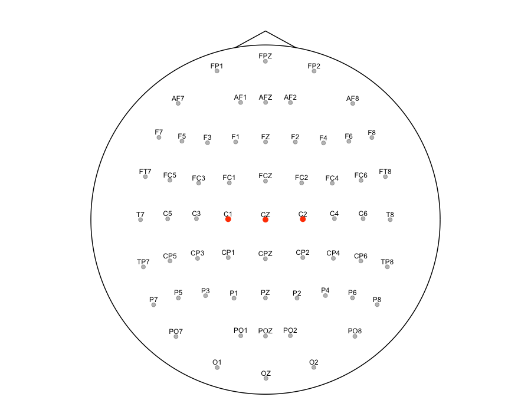
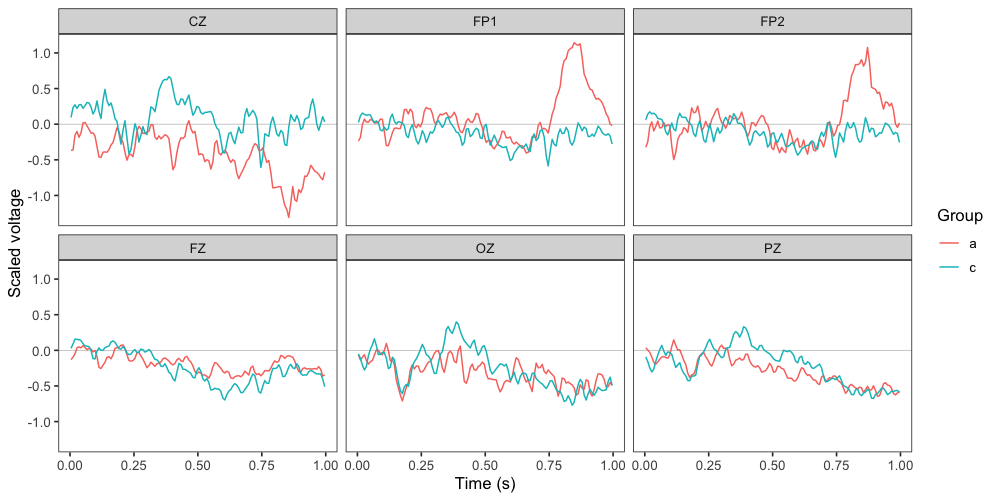
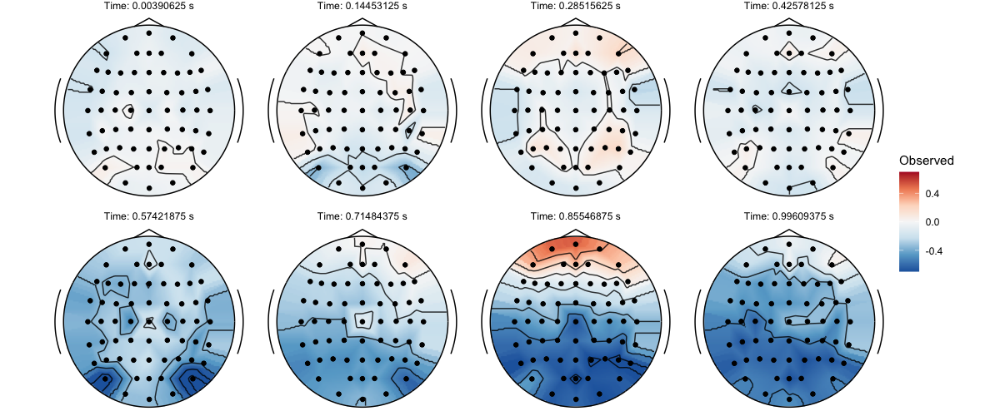
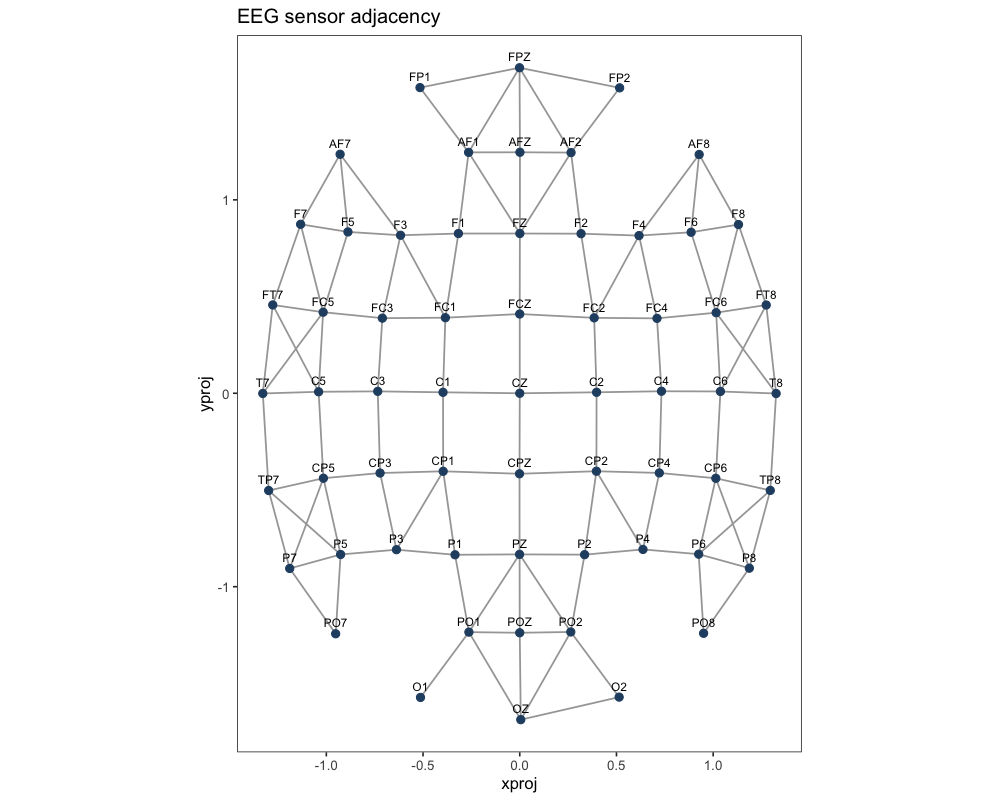
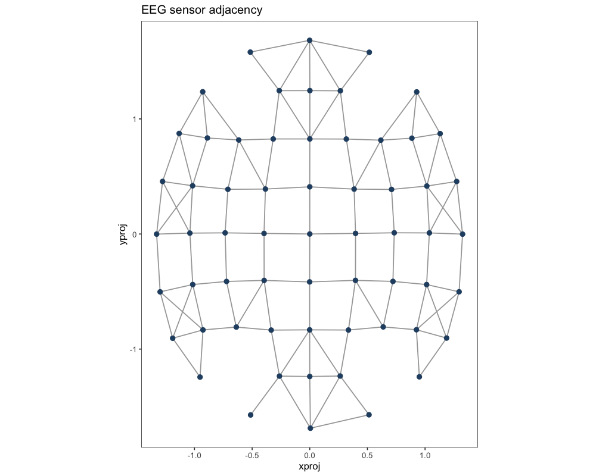
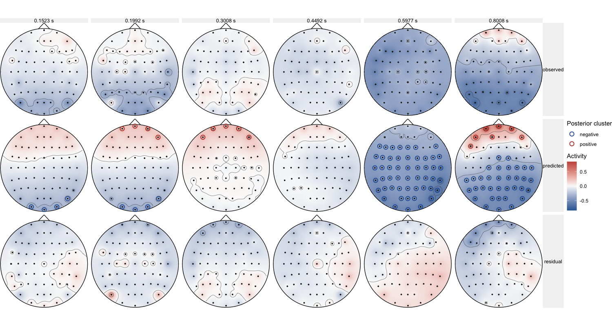
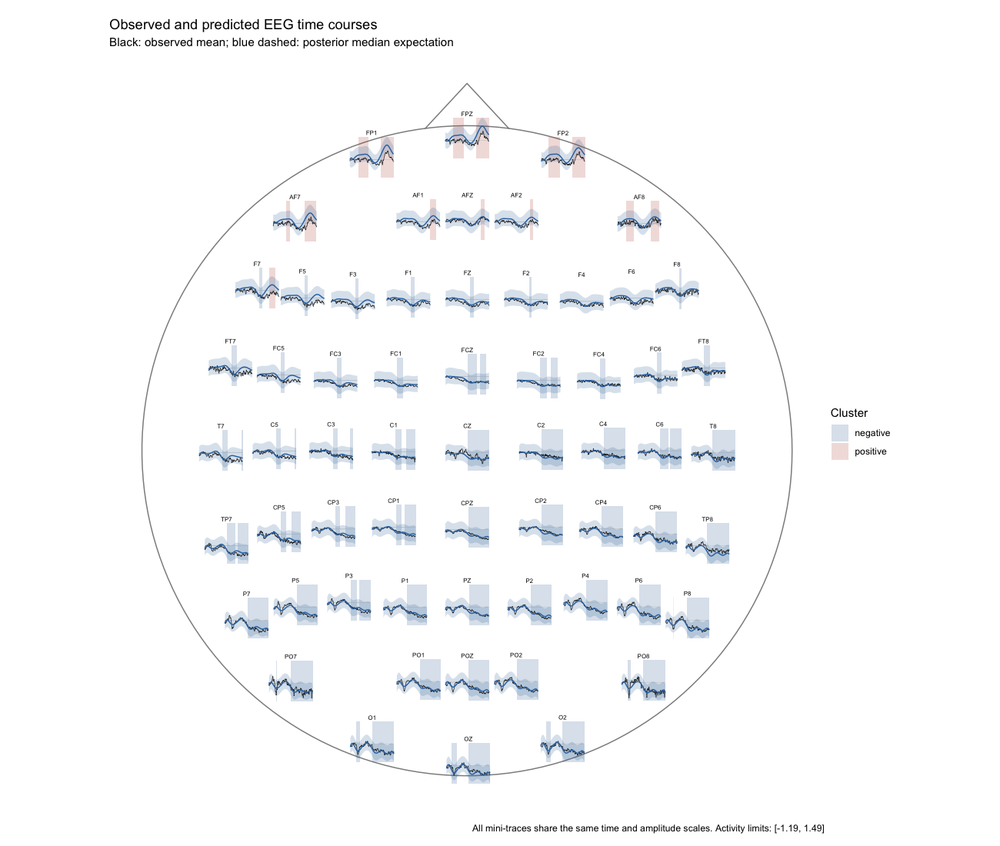
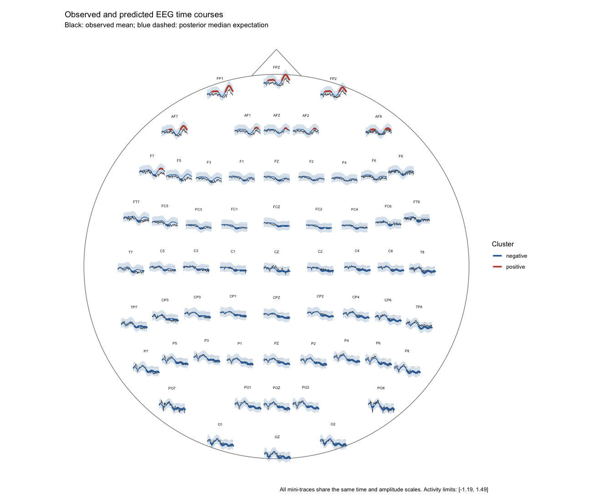
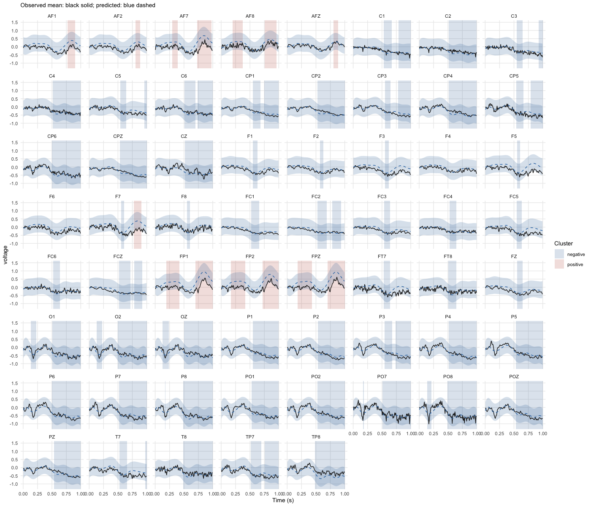

# Application to spatiotemporal EEG data

## Overview

This vignette illustrates how to model the spatial and temporal
distribution of EEG activity using **Bayesian generalised additive
multilevel models** (BGAMMs) in `neurogam`. The spatial dimension is
represented by two projected electrode coordinates, and the temporal
dimension by continuous time. The analysis combines a smooth
spatial–temporal model, posterior inference at each electrode and time
point, and graph-based clustering across neighbouring electrodes and
consecutive time points.

The workflow provides:

1.  Sensor coordinates and an automatically inferred, inspectable
    adjacency graph.
2.  A shared spatial–temporal tensor-product smooth with
    participant-level varying intercepts.
3.  One-sample inference or contrasts between two categorical
    conditions.
4.  Cluster summaries and exact sensor-by-time cluster memberships.
5.  Scalp maps of observed, predicted, and residual activity, and
    sensor-level time courses with either rectangular or line-segment
    cluster highlighting.

## Importing and preparing the EEG data

We use example EEG recordings from the [`eegkitdata`
package](https://cran.r-project.org/package=eegkitdata) and sensor
coordinates supplied with
[`eegkit`](https://cran.r-project.org/package=eegkit). The dataset
contains multiple trials recorded at 256 Hz for 20 participants, with
group, channel, and time identifiers. The example below selects five
participants per group and keeps every second time sample to make the
preprocessing and figures reasonably fast.

``` r

library(neurogam)
library(ggplot2)
library(dplyr)

# use the ggplot2 neurogam theme
theme_set(theme_neurogam() )

data("eegdata", package = "eegkitdata")
data("eegcoord", package = "eegkit")

# Inspect the variables and the montage
# dplyr::glimpse(eegdata)
# head(eegcoord[, c("xproj", "yproj")] )

# Choose five participants from each group for this worked example
subjects_keep <- eegdata |>
    distinct(subject, group) |>
    group_by(group) |>
    slice_head(n = 5L) |>
    ungroup() |>
    pull(subject)

# Keep every second time sample, the raw time variable indexes samples
eeg_subset <- eegdata |>
    dplyr::filter(
        subject %in% subjects_keep,
        time %% 2L == 0L
        )

# Coordinates are identified by row names in eegcoord
eeg_coords <- eegcoord |>
    mutate(channel = rownames(eegcoord) ) |>
    select(channel, xproj, yproj)

# Use a common x/y scale so that relative sensor distances are preserved
spatial_scale <- max(
    stats::sd(eeg_coords$xproj),
    stats::sd(eeg_coords$yproj)
    )

voltage_scale <- stats::sd(eeg_subset$voltage, na.rm = TRUE)

# Compute each participant's mean waveform before multilevel modelling
# Preserve group so that a between-participant contrast remains possible
eeg_data <- eeg_subset |>
    summarise(
        voltage = mean(voltage, na.rm = TRUE),
        .by = c(subject, group, channel, time)
        ) |>
    left_join(eeg_coords, by = "channel") |>
    dplyr::filter(!is.na(xproj), !is.na(yproj), is.finite(voltage) ) |>
    mutate(
        subject = factor(subject),
        group = droplevels(factor(group) ),
        channel = as.character(channel),
        time = (time + 1) / 256,
        xproj = xproj / spatial_scale,
        yproj = yproj / spatial_scale,
        voltage = voltage / voltage_scale
        )

# There must be one unique coordinate pair per sensor
sensors <- eeg_data |>
    distinct(channel, xproj, yproj) |>
    arrange(channel)

# Display a few rows
head(eeg_data)
#>       subject group channel       time      voltage      xproj    yproj
#> 1 co2a0000364     a     FP1 0.00390625 -0.009262861 -0.5157747 1.580363
#> 2 co2a0000364     a     FP1 0.01171875  0.163076204 -0.5157747 1.580363
#> 3 co2a0000364     a     FP1 0.01953125  0.761465353 -0.5157747 1.580363
#> 4 co2a0000364     a     FP1 0.02734375  0.842567312 -0.5157747 1.580363
#> 5 co2a0000364     a     FP1 0.03515625  0.426776990 -0.5157747 1.580363
#> 6 co2a0000364     a     FP1 0.04296875  0.305092899 -0.5157747 1.580363
```

The response is divided by a single constant (`voltage_scale`) and is
therefore expressed in scaled voltage units. The same scaling applies to
model predictions and observed waveforms; to recover the original
microvolt scale, multiply by `voltage_scale`. We do **not**
independently standardise the two spatial axes, because anisotropic
scaling would distort electrode distances and the automatically
estimated adjacency graph.

The original recordings provide only post-stimulus time points. No
pre-stimulus baseline is available here; therefore, testing voltage
against zero is not the same as testing a baseline-corrected ERP against
zero.

### Visualise the sensors and observed activity

``` r

plot_sensors(
    sensors,
    show_points = TRUE,
    show_labels = TRUE,
    label_col = "channel",
    label_repel = FALSE,
    highlight = c("C1", "CZ", "C2"),
    label_only_highlight = FALSE,
    dim_others = TRUE,
    head_expand = 1.1
    )
```



A quick quality-control plot shows grand-average sensor waveforms. For
clarity, we display a small set of channels.

``` r

channels_to_show <- intersect(
    c("FZ", "CZ", "PZ", "OZ", "FP1", "FP2"),
    unique(eeg_data$channel)
    )

if (!length(channels_to_show) ) {
    
    channels_to_show <- head(sort(unique(eeg_data$channel) ), 6L)
    
}

eeg_data |>
    filter(channel %in% channels_to_show) |>
    summarise(
        voltage = mean(voltage),
        .by = c(group, channel, time)
        ) |>
    ggplot(aes(x = time, y = voltage, colour = group)) +
    geom_hline(yintercept = 0, linewidth = 0.25, colour = "grey75") +
    geom_line(linewidth = 0.5) +
    facet_wrap(~channel, ncol = 3L) +
    labs(x = "Time (s)", y = "Scaled voltage", colour = "Group")
```



We can also display observed scalp maps at selected times using
[`plot_eeg()`](https://lnalborczyk.github.io/neurogam/reference/plot_eeg.md).
Spatial interpolation is used only for visualisation; our subsequent
inference evaluates model predictions at the actual sensor locations.

``` r

all_times <- sort(unique(eeg_data$time) )

selected_times <- all_times[
    unique(round(seq(1, length(all_times), length.out = 8L) ) )
    ]

observed_maps <- eeg_data |>
    summarise(
        voltage = mean(voltage),
        .by = c(channel, time, xproj, yproj)
        ) |>
    filter(time %in% selected_times)

plot_eeg(
    x = observed_maps,
    type = "topo",
    sensors = sensors,
    times = selected_times,
    grid_res = 120,
    value_col = "voltage",
    facet_nrow = 2,
    fill_limits = "global_quantile"
    )
```



## Estimating and inspecting EEG sensor adjacency

Spatio-temporal clusters require a definition of *which sensors are
neighbours*.
[`make_sensor_adjacency()`](https://lnalborczyk.github.io/neurogam/reference/make_sensor_adjacency.md)
estimates a symmetric adjacency matrix from projected coordinates by
selecting spatial nearest neighbours and optionally rejecting
excessively long edges. The default `k = 4` and `distance_factor = 1.8`
are **heuristics**, not guaranteed to represent the physical electrode
montage perfectly.

``` r

sensor_adjacency <- make_sensor_adjacency(
    data = sensors,
    sensor_id = "channel",
    spatial_id = c("xproj", "yproj"),
    k = 4L,
    distance_factor = 1.8
    )
```

``` r

plot_sensor_adjacency(
    data = sensors,
    adjacency = sensor_adjacency,
    sensor_id = "channel",
    spatial_id = c("xproj", "yproj"),
    show_labels = TRUE
    )
```



Inspect the graph for unexpected connections across distant scalp
regions, isolated sensors, and gaps near the head boundary. You can
adjust `k` and `distance_factor` or use an externally defined sensor
adjacency matrix. The same matrix should be retained for reproducible
inference. The built-in plotting function draws edges in the **2D
projection**, not on a physical three-dimensional head surface.

For convenience, `testing_through_time(sensor_adjacency = NULL, ...)`
constructs adjacency automatically. We pass our inspected graph
explicitly in the fitting example below so that the clustering
neighbourhood is fixed and documented.

## Fitting a spatiotemporal BGAMM

### Model specification

Let \\y\_{i,s,t}\\ denote the participant-level mean voltage for
participant \\i\\, sensor \\s\\, and time \\t\\. Our initial model is

\\ y\_{i,s,t} \sim \mathcal{N}(\mu\_{i,s,t},\sigma^2), \qquad
\mu\_{i,s,t}=\beta_0+f(x_s,y_s,t)+b_i, \\

where \\f(x,y,t)\\ is a smooth function of two electrode coordinates and
time, and \\b_i\\ is a participant-specific random intercept. We use a
tensor-product smooth with a **two-dimensional spatial marginal** and a
**one-dimensional temporal marginal**:

``` r

# Conceptual brms formula, using participant-level mean observations:
outcome_mean ~
    t2(
        xproj, yproj, time,
        bs = c("ps", "ps"),
        k = c(15, 10),
        d = c(2, 1)
        ) +
    (1 | participant)
```

The `d = c(2, 1)` argument defines two tensor-product marginals: one
comprising \\(x,y)\\ and another comprising time. Accordingly,
`k = c(15, 10)` specifies the basis dimensions for **two marginals**,
rather than a separate basis dimension for each of the three
coordinates. The `k` values control basis flexibility, not the exact
number of observed electrodes or time samples. See the [mgcv
tensor-product
documentation](https://stat.ethz.ch/R-manual/R-patched/library/mgcv/help/te.html)
and [Pedersen et
al. (2019)](https://pmc.ncbi.nlm.nih.gov/articles/PMC6542350/).

`neurogam` constructs the formula automatically. We can inspect it
without fitting anything:

``` r

formula_st <- make_bgam_formula(
    family = gaussian(),
    multilevel = "summary",
    predictor_type = "none",
    time_id = "time",
    space_id = c("xproj", "yproj"),
    kvalue = c(15, 10),
    bs = c("ps", "ps"),
    tensor_d = c(2, 1),
    varying_smooth = FALSE,
    use_se = FALSE
    )

formula_st
#> outcome_mean ~ 1 + t2(xproj, yproj, time, bs = c("ps", "ps"), k = c(15, 10), d = c(2, 1), full = FALSE) + (1 | participant)
```

The high-level workflow works with **participant-level means**, not
necessarily the original trial-level observations. Because we have
already averaged trials within each participant × sensor × time cell and
have not supplied a standard error, we use `use_se = FALSE`. When
supplying trial-level observations with two or more repetitions per
cell, or a precomputed standard error column, `use_se = TRUE` allows
measurement-error modelling via `se(outcome_sem, sigma = TRUE)`. These
two approaches do not imply identical likelihoods or uncertainty
estimates.

### Fit the integrated model

The following block fits the model and immediately evaluates posterior
expected voltage at each observed sensor × time point. The fitted
`brmsfit` object and clustering results are returned together by
[`testing_through_time()`](https://lnalborczyk.github.io/neurogam/reference/testing_through_time.md).

``` r

results_st <- testing_through_time(
    data = eeg_data,
    participant_id = "subject",
    outcome_id = "voltage",
    predictor_id = NA_character_,
    sensor_id = "channel",
    time_id = "time",
    space_id = c("xproj", "yproj"),
    family = gaussian(),
    multilevel = "summary",
    use_se = FALSE,
    varying_smooth = FALSE,
    kvalue = c(15, 10),
    bs = c("ps", "ps"),
    tensor_d = c(2, 1),
    sensor_adjacency = sensor_adjacency,
    chance_level = 0,
    rope = 0,
    threshold = 10,
    threshold_type = "both",
    n_post_samples = 500,
    chunk_size = 256L,
    re_formula = NA,
    warmup = 1000,
    iter = 3000,
    chains = 2,
    cores = 2,
    backend = "cmdstanr",
    seed = 20261027,
    threads = brms::threading(threads = 4),
    file = "cache/eeg_st_results"
    )
```

**Runtime and convergence.** Spatiotemporal models can take many hours.
Begin with a small, balanced subset of participants and decimated time
points when checking model specification, then increase data resolution
and basis dimensions for the scientific analysis. `cores = 2` and
`threads = brms::threading(threads = 4)` can use approximately eight CPU
threads when two chains run concurrently; this is not equivalent to four
total cores. Within-chain threading may not speed up every model. For
final inference, inspect convergence diagnostics (including \\\widehat
R\\, effective sample sizes, divergences, and posterior predictive
checks) and consider additional chains if computational resources
permit. See the [brms threading
guide](https://paulbuerkner.com/brms/reference/threading.html).

Predictions use `re_formula = NA`, targeting the fitted population-level
mean rather than an individual participant’s random intercept. This does
not itself incorporate a distribution of unobserved participant-specific
spatial–temporal deviations; such smooths are not currently fitted by
this interface.

### Reuse an independently fitted `brms` model

If you already fitted a model directly with
[`brms::brm()`](https://paulbuerkner.com/brms/reference/brm.html) (for
example, `voltage ~ t2(xproj, yproj, time, ...) + (1 | subject)`), the
fitted object’s data and variable names may not match the standardised
[`testing_through_time()`](https://lnalborczyk.github.io/neurogam/reference/testing_through_time.md)
interface. Instead, use the lower-level
[`analyse_bgam_spatiotemporal()`](https://lnalborczyk.github.io/neurogam/reference/analyse_bgam_spatiotemporal.md)
function, which does not refit the model:

``` r

# `st_gam` is an existing brmsfit object using subject, channel, xproj,
# yproj, time, and voltage as in the original direct-brms example.
prediction_grid <- merge(
    sensors,
    data.frame(time = sort(unique(eeg_data$time) ) ),
    by = NULL,
    sort = FALSE
    )

prediction_grid$subject <- eeg_data$subject[1L]

model_path <- "cache/eeg_st_model.rds"
model_st <- readRDS(model_path)

results_external <- analyse_bgam_spatiotemporal(
    model = model_st,
    newdata = prediction_grid,
    sensor_id = "channel",
    time_id = "time",
    spatial_id = c("xproj", "yproj"),
    sensor_adjacency = sensor_adjacency,
    null_value = 0,
    rope = 0,
    threshold = 10,
    draw_ids = seq_len(500),
    chunk_size = 256L,
    re_formula = NA
    )
```

Ensure that the prediction grid uses the **same coordinate and outcome
scaling as the independently fitted model**. A model fitted to all
trials has a different likelihood from a model fitted to
participant-level means; their predictions and uncertainties need not
agree exactly.

## Posterior inference and spatiotemporal clusters

### Summarising the fitted spatiotemporal analysis

The returned object has dedicated
[`summary()`](https://rdrr.io/r/base/summary.html) and
[`plot()`](https://rdrr.io/r/graphics/plot.default.html) methods, so in
most cases there is no need to access its internal components directly.

``` r

summary(results_external)
#> 
#> ==== Time-resolved GAM results ================================
#>   Analysis: Spatiotemporal EEG (sensor x time)
#>   Model coordinates: xproj, yproj, time
#>   Cluster coordinates: channel, time
#>   Contrast: one_sample
#>   Posterior odds mode: directional_rope
#>   Odds threshold: 10
#>   Clusters found: 11
#> 
#> Model and inference:
#>   Backend: brmsfit
#>   Posterior draws: 4000
#>   Threshold direction: both
#>   Null value: 0
#>   ROPE half-width: 0
#>   Credible interval: 0.95
#>   Sensor adjacency: provided
#>   Prediction locations: 7808
#>   Cluster member points: 2606
#> 
#> Cluster statistics:
#>   By sign: negative = 5; positive = 6
#>   Total cluster points: 2606
#>   Median cluster size: 26
#>   Mean duration: 0.182
#>   Median duration: 0.172
#>   Maximum sensors in one cluster: 51
#> 
#> Cluster table:
#> 
#>      sign id onset offset duration n_points time_min time_max n_sensors
#>  positive  1 0.176  0.426    0.250       93    0.176    0.426         3
#>  positive  2 0.199  0.371    0.172       23    0.199    0.371         1
#>  positive  3 0.301  0.387    0.086       12    0.301    0.387         1
#>  positive  4 0.707  0.996    0.289      149    0.707    0.996         6
#>  positive  5 0.730  0.973    0.242       49    0.730    0.973         2
#>  positive  6 0.762  0.957    0.195       26    0.762    0.957         1
#>  negative  7 0.129  0.230    0.102       26    0.129    0.230         2
#>  negative  8 0.137  0.223    0.086       12    0.137    0.223         1
#>  negative  9 0.145  0.207    0.062       10    0.145    0.207         2
#>  negative 10 0.176  0.184    0.008        2    0.176    0.184         1
#>  negative 11 0.488  0.996    0.508     2204    0.488    0.996        51
#> =================================================================
```

### Inspect the adjacency actually used

The output stores both the matrix and its provenance, which is important
if the adjacency was estimated automatically.

``` r

plot_sensor_adjacency(
    data = results_external$sensor_positions,
    adjacency = results_external$sensor_adjacency,
    sensor_id = "channel",
    spatial_id = c("xproj", "yproj"),
    show_labels = FALSE
    )
```



## Visualising model predictions and clusters

### Scalp topographies through time

[`plot_spatiotemporal_topography()`](https://lnalborczyk.github.io/neurogam/reference/plot_spatiotemporal_topography.md)
combines **observed grand means**, **posterior expected activity**, and
**residual mean activity** (`observed - predicted`) at selected times.
The function returns a `ggplot` object and can show one or several of
these panels.

``` r

plot_spatiotemporal_topography(
    results = results_external,
    observed_data = eeg_data,
    outcome_id = "voltage",
    sensor_id = "channel",
    time_id = "time",
    spatial_id = c("xproj", "yproj"),
    participant_id = "subject",
    times = c(0.15, 0.20, 0.30, 0.45, 0.60, 0.80),
    what = c("observed", "predicted", "residual"),
    cluster_overlay = "predicted",
    contour = TRUE,
    show_sensors = TRUE,
    head_outline = TRUE
    )
```



``` r


# OR plot(x = results_external, type = "topography", observed_data = eeg_data)
```

Requested times are matched to the nearest predicted time point. The
default diverging scale is shared across the panels, making
observed/predicted amplitudes and residuals visually comparable. If
preferred, set `limits = 2` for a fixed symmetric range in scaled
voltage units or use a smaller `n_times` when not supplying explicit
`times`.

Cluster markings identify **electrodes** belonging to connected
components at the selected time. Their exact membership is not inferred
from interpolated pixels. For figures focused on model predictions, use
`what = "predicted"`; for diagnostics, the three-row
observed/predicted/residual layout is preferable.

### Sensor-level time courses: scalp layout

[`plot_sensor_trajectories()`](https://lnalborczyk.github.io/neurogam/reference/plot_sensor_trajectories.md)
displays observed average voltage and posterior model predictions
through time, together with optional credible intervals. With
`layout = "scalp"`, the traces are placed approximately at their
corresponding electrode coordinates and share an amplitude scale.

Two styles of cluster highlighting are available.

**1. Translucent rectangles**, marking periods during which a sensor
belongs to a detected cluster:

``` r

plot_sensor_trajectories(
    results = results_external,
    observed_data = eeg_data,
    outcome_id = "voltage",
    sensor_id = "channel",
    participant_id = "subject",
    layout = "scalp",
    cluster_style = "rectangles",
    cluster_alpha = 0.2,
    show_ci = TRUE
    )
```



``` r


# OR plot(x = results_external, type = "trajectories", observed_data = eeg_data)
```

**2. Highlighted prediction-line segments**, emphasizing the portion of
each predicted waveform that belongs to a cluster:

``` r

plot_sensor_trajectories(
    results = results_external,
    observed_data = eeg_data,
    outcome_id = "voltage",
    sensor_id = "channel",
    participant_id = "subject",
    layout = "scalp",
    cluster_style = "segments",
    highlighted_linewidth = 1.2,
    show_ci = TRUE
    )
```



Cluster intervals are constructed independently for each sensor and do
**not** bridge disconnected portions of the time grid. Positive and
negative regions use distinct colors. The highlighted segments refer to
predictions; observed activity is shown for model-fit comparison.

### Sensor-level time courses: faceted layout

The scalp layout is useful for viewing spatial organisation. The faceted
alternative provides more room to inspect individual waveforms and
uncertainties.

``` r

plot_sensor_trajectories(
    results = results_external,
    observed_data = eeg_data,
    outcome_id = "voltage",
    sensor_id = "channel",
    participant_id = "subject",
    layout = "facets",
    cluster_style = "rectangles",
    ncol = 8L,
    free_y = FALSE,
    show_ci = TRUE
    )
```



You can select a smaller sensor subset with
`sensors = c("FZ", "CZ", "PZ")`, switch to `cluster_style = "segments"`,
or turn off highlighting using `cluster_style = "none"`. Keeping
`free_y = FALSE` facilitates across-sensor amplitude comparisons;
setting it to `TRUE` can reveal low-amplitude responses but changes the
displayed scale across panels.

## Practical recommendations and limitations

- **Sampling and model complexity.** Begin with a reduced time grid and
  conservative basis dimensions, then check sensitivity to `kvalue`,
  `bs`, and spatial projections. A larger basis permits more complex
  patterns but substantially increases computation.
- **Multilevel structure.** Participant-specific random intercepts allow
  different mean voltages but do not capture individual spatiotemporal
  surface deviations. A random-intercept-only model may under-represent
  between-participant variation in spatial localization or onset.
- **Observed versus fitted activity.** The displayed residual
  topographies show the difference between *grand-average observed
  activity* and *population-level expected predictions*. They are
  descriptive fit diagnostics, not trial-level residuals or a substitute
  for posterior predictive checks.
- **Spatial geometry.** Projected 2D positions approximate sensor
  layout; smoothing and graph adjacency use different aspects of that
  representation. Report the coordinate projection, adjacency method,
  `k`, and distance filter used.
- **Reproducibility.** Save fitted models or result objects, the
  adjacency graph, package versions, random seed, basis specification,
  posterior draw count, and inference thresholds. Consider retaining all
  posterior draws for final analyses even if a smaller subset is used
  for exploratory plots.

The methods generalise naturally to other sensor-by-time signals. For
scientific analyses, model selection, sensitivity checks, and
participant-level uncertainty should be treated as part of the
inferential workflow, not merely as plotting details.
