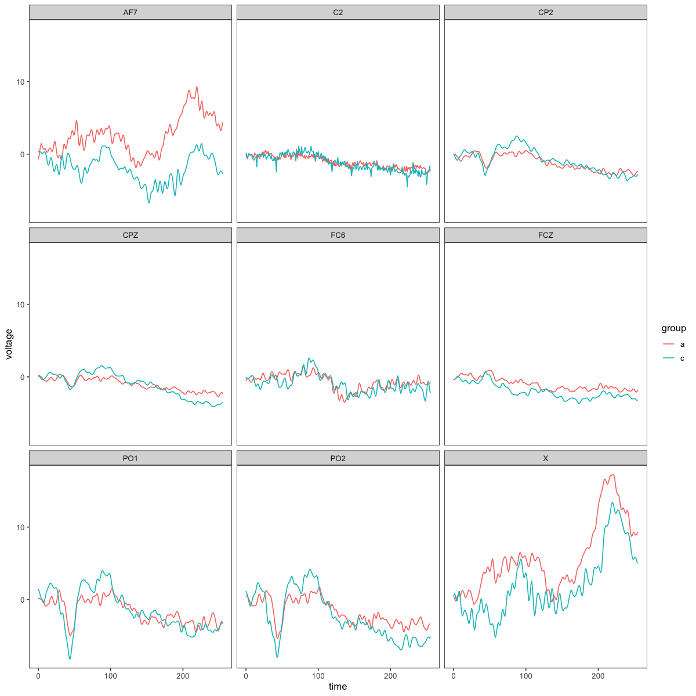
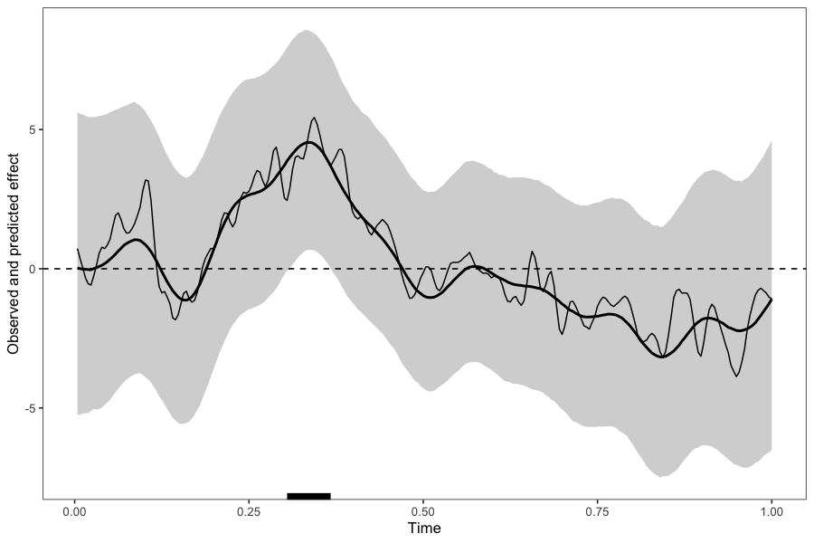
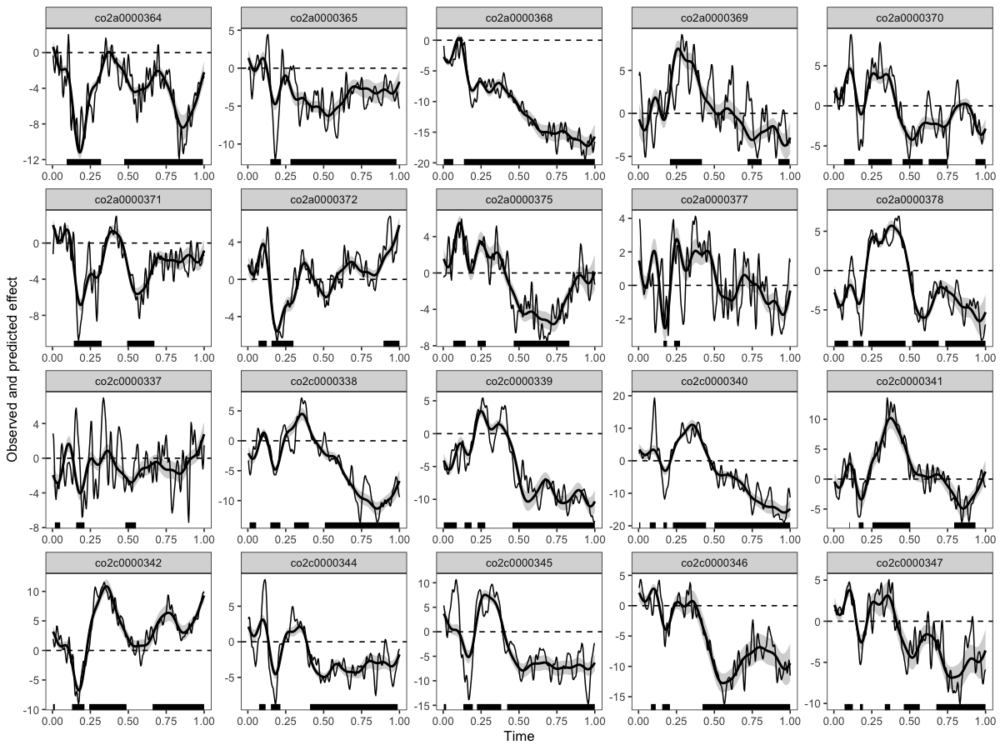
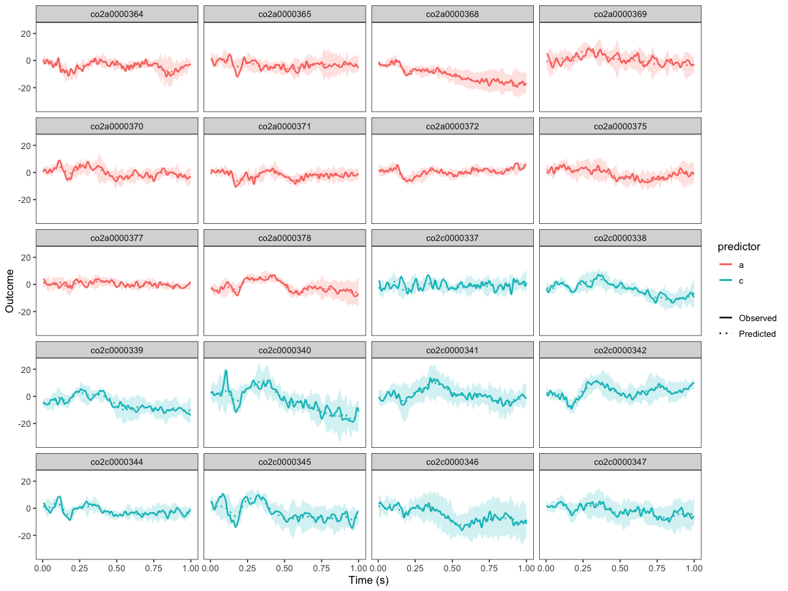

# Application to 1D temporal EEG data

## Importing and visualising EEG data

In this vignette, we illustrate how to analyse one-dimensional EEG time
series using Bayesian generalised additive multilevel models (BGAMMs).
We use an example dataset from the [`eegkit`
package](https://CRAN.R-project.org/package=eegkit), containing
event-related potentials (ERPs) recorded from multiple participants,
channels, and experimental groups. First, we import the data and
visualise the average ERP waveforms across groups for a selection of
channels.

``` r

library(neurogam)
library(ggplot2)
library(eegkit)
library(dplyr)

# Change default brms backend
options(brms.backend = "cmdstanr")

# Use the ggplot2 neurogam theme
theme_set(theme_neurogam() )

# Import eegdata
data("eegdata", package = "eegkitdata")

# plotting the average ERP per group and some channels
eegdata |>
    summarise(voltage = mean(voltage), .by = c(group, channel, time) ) |>
    filter(channel %in% sample(x = unique(levels(eegdata$channel) ), size = 9) ) |> 
    ggplot(aes(x = time, y = voltage, colour = group) ) +
    geom_line() +
    facet_wrap(~channel)
```



For simplicity, we focus on a single channel (`P6`), convert time to
seconds, round numerical values, and remove missing observations.

``` r

# reshape the data
eeg_data <- eegdata |>
    # keeping only one channel
    dplyr::filter(channel == "P6") |>
    # converting timesteps to seconds
    mutate(time = (time + 1) / 256) |>
    # rounding numeric variables
    mutate(across(where(is.numeric), ~ round(.x, 4) ) ) |>
    # removing NAs
    na.omit()

# show a few rows
head(eeg_data)
#>       subject group condition trial channel   time voltage
#> 1 co2a0000364     a        S1     0      P6 0.0039  -2.909
#> 2 co2a0000364     a        S1     0      P6 0.0078  -4.862
#> 3 co2a0000364     a        S1     0      P6 0.0117  -5.351
#> 4 co2a0000364     a        S1     0      P6 0.0156  -4.374
#> 5 co2a0000364     a        S1     0      P6 0.0195  -1.933
#> 6 co2a0000364     a        S1     0      P6 0.0234   0.997
```

## Fitting the model

We first fit a BGAMM to assess differences between experimental groups
over time. The model estimates smooth temporal trajectories while
accounting for participant-level variability. Statistical evidence is
assessed using posterior odds, with a threshold of 10.

``` r

# fitting the BGAMM to identify clusters (around 30 min on 4 parallel apple M4 cores)
results <- testing_through_time(
    # EEG data
    data = eeg_data,
    # participant column
    participant_id = "subject",
    # EEG column
    outcome_id = "voltage",
    # name of predictor in data
    predictor_id = "group",
    # basis dimension
    kvalue = 20,
    # baseline period
    baseline_window = c(0, 0.1),
    # we recommend fitting the GAMM on summary statistics (mean and SD)
    multilevel = "summary",
    # threshold on posterior odds
    threshold = 10,
    # participant-specific smooth?
    varying_smooth = TRUE,
    # number of MCMCs
    chains = 4,
    # number of parallel cores
    cores = 4,
    # save the model
    file = "cache/temporal_model"
    )
```

### Visualising the results

The [`print()`](https://rdrr.io/r/base/print.html) method summarises the
identified temporal clusters, whereas
[`plot()`](https://rdrr.io/r/graphics/plot.default.html) displays the
observed data, posterior predictions, and clusters supported by the
specified posterior odds threshold.

``` r

# displaying the identified clusters
print(results)
#> 
#> ==== Time-resolved GAM results ================================
#>   Analysis: Temporal (1D)
#>   Model coordinates: time
#>   Cluster coordinates: time
#>   Contrast: condition_difference
#>   Posterior odds mode: directional_rope
#>   Odds threshold: 10
#>   Clusters found: 1
#> 
#> Cluster table:
#> 
#>      sign id onset offset duration n_points time_min time_max
#>  positive  1 0.305  0.367    0.062       17    0.305    0.367
#> =================================================================
```

``` r

# plotting the data, model's predictions, and clusters
plot(results)
```



### Computing clusters at the participant-level

We can also identify temporal clusters separately for each participant.
Here, we omit the group predictor (`predictor_id = NA`) and set
`participant_clusters = TRUE` to assess when EEG amplitude differs from
zero, at both the group and participant levels. Because group membership
is constant within participants, the group contrast is not included in
this analysis.

``` r

# fitting the BGAMM to identify clusters
results_ppt <- testing_through_time(
    # EEG data
    data = eeg_data,
    # participant column
    participant_id = "subject",
    # EEG column
    outcome_id = "voltage",
    # baseline period
    baseline_window = c(0, 0.1),
    # here we use no predictor (because group varies across participants)
    predictor_id = NA,
    # group basis dimension
    kvalue = 20,
    # we recommend fitting the GAMM with summary statistics (mean and SD)
    multilevel = "summary",
    # return clusters at both the group and participant levels
    participant_clusters = TRUE,
    # threshold on posterior odds
    threshold = 10,
    # number of MCMCs
    chains = 4,
    # number of parallel cores
    cores = 4
    )
```

### Visualising participant-level results

As before, we can inspect the identified clusters using the dedicated
[`print()`](https://rdrr.io/r/base/print.html) and
[`plot()`](https://rdrr.io/r/graphics/plot.default.html) methods.

``` r

# displaying the identified clusters
print(results_ppt)
#> 
#> ==== Time-resolved GAM results ================================
#>   Analysis: Temporal (1D)
#>   Model coordinates: time
#>   Cluster coordinates: time
#>   Contrast: one_sample
#>   Posterior odds mode: directional_rope
#>   Odds threshold: 10
#>   Clusters found: 69
#> 
#> Cluster table:
#> 
#>  participant     sign id onset offset duration n_points time_min time_max
#>  co2a0000364 negative  1 0.094  0.320    0.226       59    0.094    0.320
#>  co2a0000364 negative  2 0.473  0.992    0.519      134    0.473    0.992
#>  co2a0000365 negative  1 0.148  0.219    0.070       19    0.148    0.219
#>  co2a0000365 negative  2 0.281  0.981    0.699      180    0.281    0.981
#>  co2a0000368 negative  1 0.004  0.066    0.062       17    0.004    0.066
#>  co2a0000368 negative  2 0.137  1.000    0.863      222    0.137    1.000
#>  co2a0000369 positive  1 0.207  0.418    0.211       55    0.207    0.418
#>  co2a0000369 negative  2 0.719  0.812    0.094       25    0.719    0.812
#>  co2a0000369 negative  3 0.922  0.996    0.074       20    0.922    0.996
#>  co2a0000370 positive  1 0.066  0.137    0.070       19    0.066    0.137
#>  co2a0000370 positive  2 0.227  0.383    0.156       41    0.227    0.383
#>  co2a0000370 negative  3 0.453  0.586    0.133       35    0.453    0.586
#>   ... 57 additional cluster(s) not shown.
#> =================================================================
```

``` r

# plotting the data, model's predictions, and clusters
plot(results_ppt)
```



### Posterior predictive checks

Posterior predictive checks (PPCs) help assess how well the model
reproduces key features of the observed data. We recommend inspecting
model predictions at both the group and participant levels. The
[`neurogam::ppc()`](https://lnalborczyk.github.io/neurogam/reference/ppc.md)
function provides convenient visualisations, whereas
[`brms::pp_check()`](https://mc-stan.org/bayesplot/reference/pp_check.html)
offers additional diagnostics (see the [bayesplot PPC
overview](https://mc-stan.org/bayesplot/reference/PPC-overview.html)).

``` r

# posterior predictive checks (PPCs) at the group level
ppc(object = results, ppc_type = "group")
```


``` r

# posterior predictive checks (PPCs) at the participant level
ppc(object = results, ppc_type = "participant")
```


