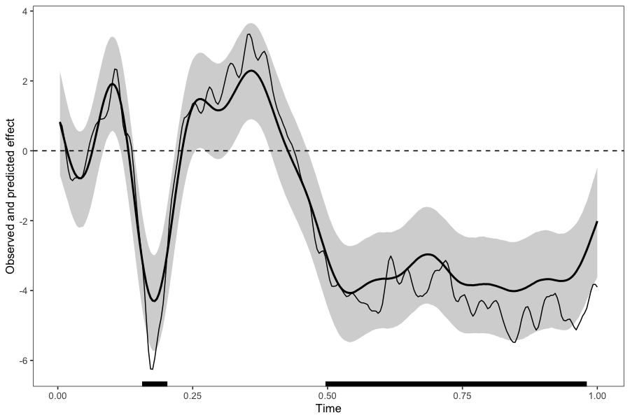
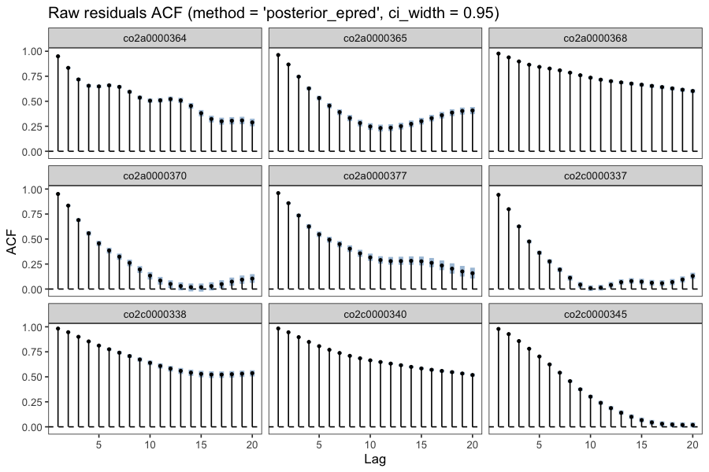
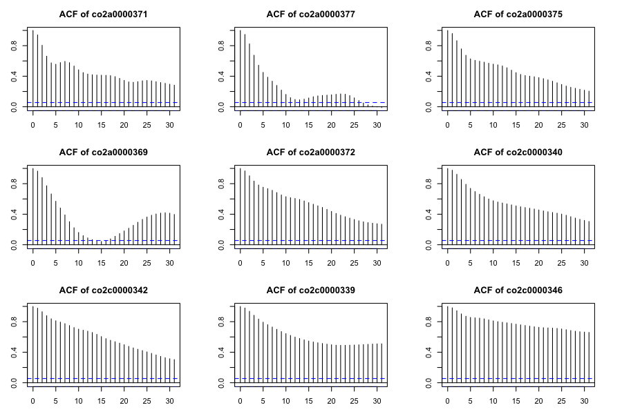
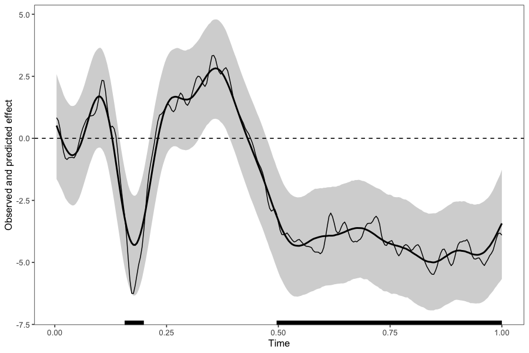
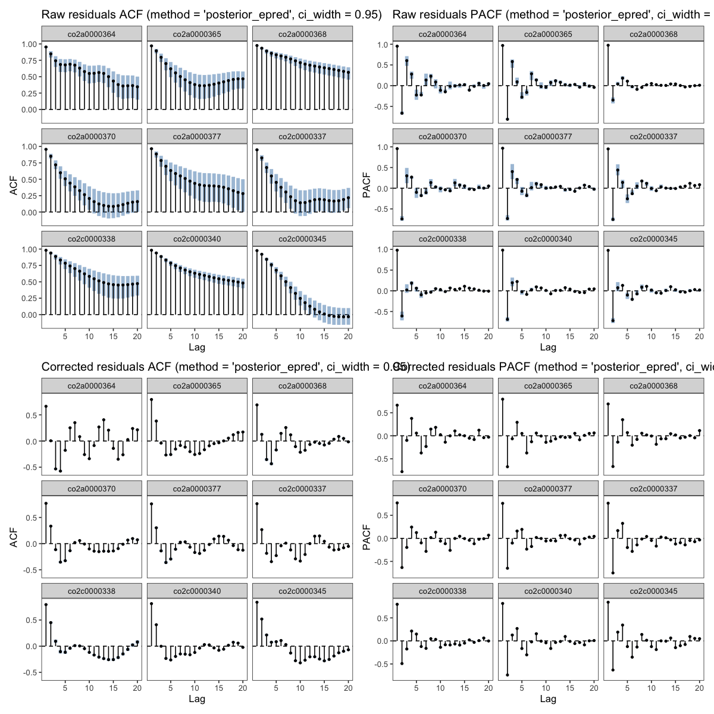
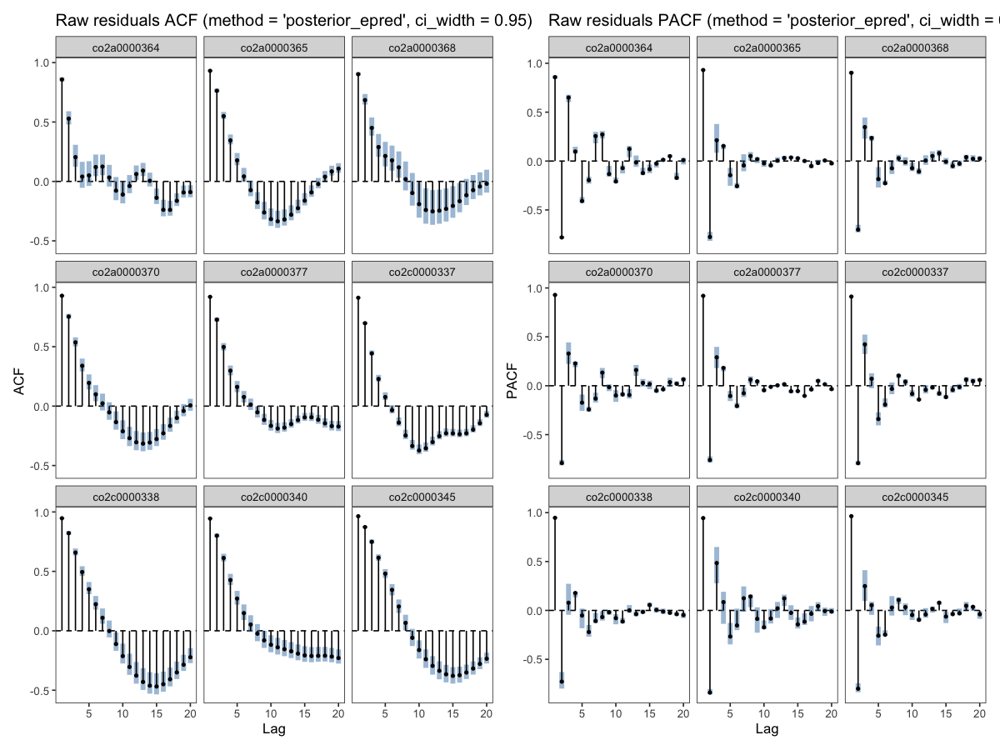
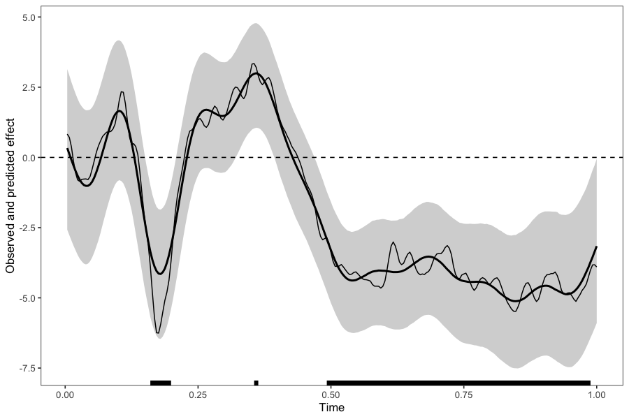

# Checking and modelling residual auto-correlation (1D temporal data)

## Importing and visualising EEG data

Below we import and reshape EEG data from the [`eegkit`
package](https://CRAN.R-project.org/package=eegkit).

``` r

library(patchwork)
library(neurogam)
library(ggplot2)
library(eegkit)
library(dplyr)

# Use the ggplot2 neurogam theme
theme_set(theme_neurogam() )

# Change default brms backend
options(brms.backend = "cmdstanr")

# Use more parallel cores for LOO model comparison
options(loo.cores = 10)

# Import eegdata
data("eegdata", package = "eegkitdata")

# Plotting the average ERP per group and channel
eegdata |>
    summarise(voltage = mean(voltage), .by = c(group, channel, time) ) |>
    filter(channel %in% sample(x = unique(levels(eegdata$channel) ), size = 9) ) |> 
    ggplot(aes(x = time, y = voltage, colour = group) ) +
    geom_line() +
    facet_wrap(~channel)
```


``` r

# reshape the data
eeg_data <- eegdata |>
    # keeping only one channel
    dplyr::filter(channel == "P6") |>
    # converting timesteps to seconds
    mutate(time = (time + 1) / 256) |>
    # rounding numeric variables
    mutate(across(where(is.numeric), ~ round(.x, 4) ) ) |>
    # removing NAs
    na.omit()

# show a few rows
head(eeg_data)
#>       subject group condition trial channel   time voltage
#> 1 co2a0000364     a        S1     0      P6 0.0039  -2.909
#> 2 co2a0000364     a        S1     0      P6 0.0078  -4.862
#> 3 co2a0000364     a        S1     0      P6 0.0117  -5.351
#> 4 co2a0000364     a        S1     0      P6 0.0156  -4.374
#> 5 co2a0000364     a        S1     0      P6 0.0195  -1.933
#> 6 co2a0000364     a        S1     0      P6 0.0234   0.997
```

## Fitting a first model

We fit the model (a BGAMM) on one channel (P6) to test for a group
difference at every timestep.

``` r

# fitting the BGAMM to identify clusters
results1 <- testing_through_time(
    # EEG data
    data = eeg_data,
    # participant column
    participant_id = "subject",
    # EEG column
    outcome_id = "voltage",
    # no predictor
    predictor_id = NA,
    # basis dimension
    kvalue = 20,
    # we recommend fitting the GAMM on summary statistics (mean and SD)
    multilevel = "summary",
    # no by-participant varying smooth (for speed purposes)
    varying_smooth = FALSE,
    # threshold on posterior odds
    threshold = 10,
    # number of MCMCs
    chains = 4,
    # number of parallel cores
    cores = 4,
    # number of warmup iterations
    warmup = 1000,
    # total number of iterations (per chain)
    iter = 2000,
    # save the model
    file = "cache/models/eeg_without_ar"
    )
```

### Visualising the results

``` r

# displaying the identified clusters
print(results1)
#> 
#> ==== Time-resolved GAM results ================================
#>   Analysis: Temporal (1D)
#>   Model coordinates: time
#>   Cluster coordinates: time
#>   Contrast: one_sample
#>   Posterior odds mode: directional_rope
#>   Odds threshold: 10
#>   Clusters found: 2
#> 
#> Cluster table:
#> 
#>      sign id onset offset duration n_points time_min time_max
#>  negative  1 0.156  0.203    0.047       13    0.156    0.203
#>  negative  2 0.496  0.981    0.484      125    0.496    0.981
#> =================================================================
```

``` r

# plotting the data, model's predictions, and clusters
plot(results1)
```



### Checking auto-correlation

Below we use the
[`check_residual_autocorrelation()`](https://lnalborczyk.github.io/neurogam/reference/check_residual_autocorrelation.md)
function to check to residual auto-correlation. The ACF plot (per
participant) reveals strong residual auto-correlation.

``` r

# checking residual auto-correlation
ar_check1 <- check_residual_autocorrelation(
    fit = results1$model
    )

# residual ACF (for some participants)
ar_check1$plots$acf_raw
```



Compare with the residuals of the equivalent `mgcv` model (see also [the
autocorrelation vignette of the `itsadug`
package](https://CRAN.R-project.org/package=itsadug)).

``` r

library(itsadug)
library(mgcv)

# fitting an equivalent mgcv model
m1 <- bam(voltage ~ s(time, k = 20) + s(subject, bs = "re"), data = eeg_data)

# plotting the raw residuals for some participants
acf_resid(model = m1, split_pred = "subject", n = 9)
#> Quantiles to be plotted:
#>        0%     12.5%       25%     37.5%       50%     62.5%       75%     87.5%      100% 
#> 0.9413553 0.9493016 0.9587952 0.9653885 0.9699884 0.9760920 0.9777241 0.9791734 0.9820861
```



## Modelling auto-correlation

The
[`testing_through_time()`](https://lnalborczyk.github.io/neurogam/reference/testing_through_time.md)
function allows including a latent AR1 model to capture unmodelled
autocorrelation (via `include_ar_term = TRUE`), which is estimated
simultaneously to the other model parameters. This contrast with
conventional approaches using a 2-step procedure consisting in first
estimating the residual auto-correlation (from a first model), and then
including this correlation as a fixed parameter in a subsequent model.
Our approach, while more computationally intense, has several
advantages:

- **Proper uncertainty propagation.** Estimating the latent AR term
  jointly with the smooth/linear effects propagates uncertainty about
  autocorrelation into *all* model parameters and predictions. In
  contrast, a 2-step “estimate then fix it” approach is a plug-in
  procedure that conditions on an uncertain quantity, which may yield
  **overconfident** intervals (too-small SEs / under-coverage).

- **Less bias from mean-correlation confounding.** Residual
  autocorrelation depends on what the mean model has already explained
  (and on smoothing penalties). When estimating autocorrelation from
  residuals of an initial fit, we risk **misallocating structure**
  between the smooth trend and the AR process. Joint estimation helps
  the model decide, probabilistically, whether variation is better
  explained by the smooth component or by autocorrelated deviations.

- **Cleaner, less error-prone prediction.** Two-step workflows often
  require awkward post-hoc steps (fit trend, extract residuals, fit AR
  model, forecast residuals, back-transform, etc.), which is tedious and
  easy to get wrong. A joint latent AR formulation gives a single
  coherent generative model for estimation *and* prediction (see also
  [this
  blogpost](https://ecogambler.netlify.app/blog/autocorrelated-gams/)).

``` r

# fitting the BGAMM to identify clusters
results2 <- testing_through_time(
    # EEG data
    data = eeg_data,
    # participant column
    participant_id = "subject",
    # EEG column
    outcome_id = "voltage",
    # no predictor
    predictor_id = NA,
    # basis dimension
    kvalue = 20,
    # we recommend fitting the GAMM on summary statistics (mean and SD)
    multilevel = "summary",
    # no by-participant varying smooth (for speed purposes)
    varying_smooth = FALSE,
    # including (estimating) auto-correlation within the same model
    include_ar_term = TRUE,
    # threshold on posterior odds
    threshold = 10,
    # number of MCMCs
    chains = 4,
    # number of parallel cores
    cores = 4,
    # number of warmup iterations
    warmup = 1000,
    # total number of iterations (per chain)
    iter = 2000,
    file = "cache/models/eeg_with_ar"
    )
```

``` r

# checking residual auto-correlation
ar_check2 <- check_residual_autocorrelation(fit = results2$model)

# checking auto-correlation estimates
ar_check2$ar_summary
#>   parameter      mean          sd     q025      q50      q975
#> 1     ar[1] 0.9848311 0.003343484 0.977792 0.985126 0.9906862
```

If the AR term correctly captured residual auto-correlation, we expect
the average lag-1 auto-correlation to be lower in the corrected
residuals than in the raw residuals.

``` r

head(x = ar_check2$rho1_by_series_raw)
#> # A tibble: 6 × 3
#>   .series     n_time  rho1
#>   <fct>        <int> <dbl>
#> 1 co2a0000364    256 0.954
#> 2 co2a0000365    256 0.970
#> 3 co2a0000368    256 0.986
#> 4 co2a0000369    256 0.961
#> 5 co2a0000370    256 0.956
#> 6 co2a0000371    256 0.966
head(x = ar_check2$rho1_by_series_corrected)
#> # A tibble: 6 × 3
#>   .series     n_time  rho1
#>   <fct>        <int> <dbl>
#> 1 co2a0000364    256 0.664
#> 2 co2a0000365    256 0.795
#> 3 co2a0000368    256 0.692
#> 4 co2a0000369    256 0.789
#> 5 co2a0000370    256 0.773
#> 6 co2a0000371    256 0.720

# average lag-1 autocorrelation across series
mean(x = ar_check2$rho1_by_series_raw$rho1, na.rm = TRUE)
#> [1] 0.970932
mean(x = ar_check2$rho1_by_series_corrected$rho1, na.rm = TRUE)
#> [1] 0.7562168
```

We then visualise the identified clusters, showing that this model
produces much more conservative estimates (because of the larger
uncertainty about group-level estimates.)

``` r

# displaying the identified clusters
print(results2)
#> 
#> ==== Time-resolved GAM results ================================
#>   Analysis: Temporal (1D)
#>   Model coordinates: time
#>   Cluster coordinates: time
#>   Contrast: one_sample
#>   Posterior odds mode: directional_rope
#>   Odds threshold: 10
#>   Clusters found: 2
#> 
#> Cluster table:
#> 
#>      sign id onset offset duration n_points time_min time_max
#>  negative  1 0.156  0.199    0.043       12    0.156    0.199
#>  negative  2 0.496  1.000    0.504      130    0.496    1.000
#> =================================================================
```

``` r

# plotting the data, model's predictions, and clusters
plot(results2)
```



We visualise both the auto-correlation (ACF) and partial
auto-correlation (pACF) of the raw and AR-corrected (whitened)
residuals.

``` r

(ar_check2$plots$acf_raw + ar_check2$plots$pacf_raw) /
    (ar_check2$plots$acf_corrected + ar_check2$plots$pacf_corrected)
```



## Model comparison

Model comparison suggests that the second model has much better
out-of-sample predictive accuracy.

``` r

# model comparison using leave-one-out cross-validation
brms::loo(results1$model, results2$model)
#> Output of model 'results1$model':
#> 
#> Computed from 4000 by 5120 log-likelihood matrix.
#> 
#>          Estimate    SE
#> elpd_loo -13678.0  50.1
#> p_loo        40.1   1.0
#> looic     27355.9 100.3
#> ------
#> MCSE of elpd_loo is 0.1.
#> MCSE and ESS estimates assume MCMC draws (r_eff in [0.6, 1.4]).
#> 
#> All Pareto k estimates are good (k < 0.7).
#> See help('pareto-k-diagnostic') for details.
#> 
#> Output of model 'results2$model':
#> 
#> Computed from 4000 by 5120 log-likelihood matrix.
#> 
#>          Estimate   SE
#> elpd_loo -10437.3 33.7
#> p_loo         1.0  0.1
#> looic     20874.6 67.5
#> ------
#> MCSE of elpd_loo is 0.0.
#> MCSE and ESS estimates assume MCMC draws (r_eff in [0.6, 2.1]).
#> 
#> All Pareto k estimates are good (k < 0.7).
#> See help('pareto-k-diagnostic') for details.
#> 
#> Model comparisons:
#>           model elpd_diff se_diff p_worse diag_diff diag_elpd
#>  results2$model       0.0     0.0      NA                    
#>  results1$model   -3240.7    50.3    1.00
```

## Lowering auto-correlation with varying smooth

Another way of reducing residual auto-correlation is to improve the
model fit to capture finer structure present in the data. Below we show
that auto-correlation can be considerably lowered by including
per-participant varying smoothers.

``` r

# fitting the BGAMM to identify clusters
results3 <- testing_through_time(
    # EEG data
    data = eeg_data,
    # participant column
    participant_id = "subject",
    # EEG column
    outcome_id = "voltage",
    # no predictor
    predictor_id = NA,
    # basis dimension
    kvalue = 20,
    # we recommend fitting the GAMM on summary statistics (mean and SD)
    multilevel = "summary",
    # no by-participant varying smooth (for speed purposes)
    varying_smooth = TRUE,
    # threshold on posterior odds
    threshold = 10,
    # number of MCMCs
    chains = 4,
    # number of parallel cores
    cores = 4,
    # number of warmup iterations
    warmup = 1000,
    # total number of iterations (per chain)
    iter = 2000,
    file = "cache/models/eeg_varying_smooth"
    )
```

``` r

# checking residual auto-correlation
ar_check3 <- check_residual_autocorrelation(fit = results3$model)

# residual ACF and pACF (for some participants)
ar_check3$plots$acf_raw + ar_check3$plots$pacf_raw
```



``` r

# displaying the identified clusters
print(results3)
#> 
#> ==== Time-resolved GAM results ================================
#>   Analysis: Temporal (1D)
#>   Model coordinates: time
#>   Cluster coordinates: time
#>   Contrast: one_sample
#>   Posterior odds mode: directional_rope
#>   Odds threshold: 10
#>   Clusters found: 3
#> 
#> Cluster table:
#> 
#>      sign id onset offset duration n_points time_min time_max
#>  positive  1 0.356  0.363    0.008        3    0.356    0.363
#>  negative  2 0.160  0.199    0.039       11    0.160    0.199
#>  negative  3 0.492  0.988    0.496      128    0.492    0.988
#> =================================================================
```

``` r

# plotting the data, model's predictions, and clusters
plot(results3)
```



## Model comparison

Model comparison suggests that this last model has slightly better
out-of-sample predictive accuracy.

``` r

# model comparison using leave-one-out cross-validation
brms::loo(results1$model, results2$model, results3$model)
#> Output of model 'results1$model':
#> 
#> Computed from 4000 by 5120 log-likelihood matrix.
#> 
#>          Estimate    SE
#> elpd_loo -13678.0  50.1
#> p_loo        40.1   1.0
#> looic     27355.9 100.3
#> ------
#> MCSE of elpd_loo is 0.1.
#> MCSE and ESS estimates assume MCMC draws (r_eff in [0.6, 1.4]).
#> 
#> All Pareto k estimates are good (k < 0.7).
#> See help('pareto-k-diagnostic') for details.
#> 
#> Output of model 'results2$model':
#> 
#> Computed from 4000 by 5120 log-likelihood matrix.
#> 
#>          Estimate   SE
#> elpd_loo -10437.3 33.7
#> p_loo         1.0  0.1
#> looic     20874.6 67.5
#> ------
#> MCSE of elpd_loo is 0.0.
#> MCSE and ESS estimates assume MCMC draws (r_eff in [0.6, 2.1]).
#> 
#> All Pareto k estimates are good (k < 0.7).
#> See help('pareto-k-diagnostic') for details.
#> 
#> Output of model 'results3$model':
#> 
#> Computed from 4000 by 5120 log-likelihood matrix.
#> 
#>          Estimate   SE
#> elpd_loo -11381.9 47.5
#> p_loo       155.4  6.6
#> looic     22763.8 95.0
#> ------
#> MCSE of elpd_loo is 0.2.
#> MCSE and ESS estimates assume MCMC draws (r_eff in [0.4, 2.1]).
#> 
#> All Pareto k estimates are good (k < 0.7).
#> See help('pareto-k-diagnostic') for details.
#> 
#> Model comparisons:
#>           model elpd_diff se_diff p_worse diag_diff diag_elpd
#>  results2$model       0.0     0.0      NA                    
#>  results3$model    -944.6    35.4    1.00                    
#>  results1$model   -3240.7    50.3    1.00
```
