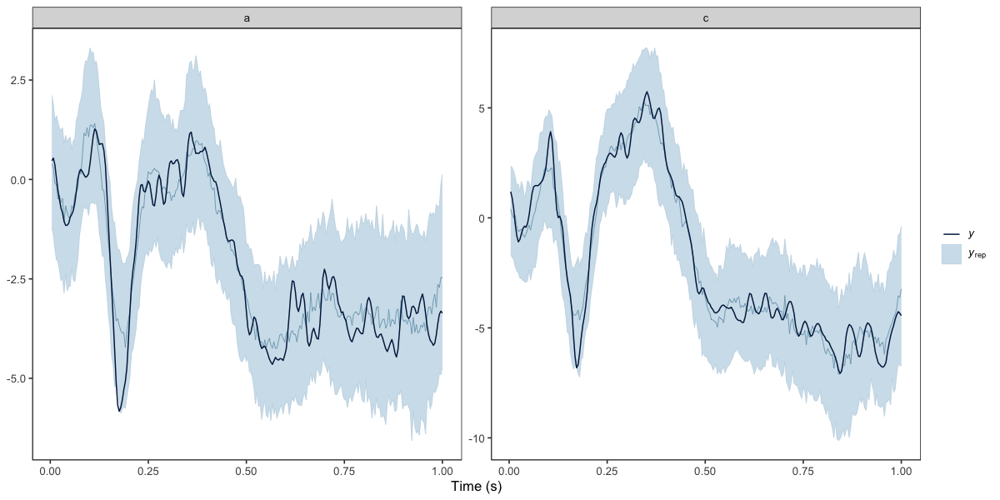

## Importing and visualising EEG data

Below we import and reshape EEG data from the [`eegkit` package](https://CRAN.R-project.org/package=eegkit).


``` r
library(neurogam)
library(ggplot2)
library(eegkit)
library(dplyr)

# Use the ggplot2 neurogam theme
theme_set(theme_neurogam() )

# retrieving some EEG data
data(eegdata)
head(eegdata)
#>       subject group condition trial channel time voltage
#> 1 co2a0000364     a        S1     0     FP1    0  -8.921
#> 2 co2a0000364     a        S1     0     FP1    1  -8.433
#> 3 co2a0000364     a        S1     0     FP1    2  -2.574
#> 4 co2a0000364     a        S1     0     FP1    3   5.239
#> 5 co2a0000364     a        S1     0     FP1    4  11.587
#> 6 co2a0000364     a        S1     0     FP1    5  14.028

# plotting the average ERP per group and channel
eegdata |>
    summarise(voltage = mean(voltage), .by = c(group, channel, time) ) |>
    ggplot(aes(x = time, y = voltage, colour = group) ) +
    geom_line() +
    facet_wrap(~channel)
```


``` r
# reshape the data
eeg_data <- eegdata |>
    # keeping only one channel
    dplyr::filter(channel == "P6") |>
    # converting timesteps to seconds
    mutate(time = (time + 1) / 256) |>
    # rounding numeric variables
    mutate(across(where(is.numeric), ~ round(.x, 4) ) ) |>
    # removing NAs
    na.omit()

# show a few rows
head(eeg_data)
#>       subject group condition trial channel   time voltage
#> 1 co2a0000364     a        S1     0      P6 0.0039  -2.909
#> 2 co2a0000364     a        S1     0      P6 0.0078  -4.862
#> 3 co2a0000364     a        S1     0      P6 0.0117  -5.351
#> 4 co2a0000364     a        S1     0      P6 0.0156  -4.374
#> 5 co2a0000364     a        S1     0      P6 0.0195  -1.933
#> 6 co2a0000364     a        S1     0      P6 0.0234   0.997
```

## Fitting the model

We fit the model (a BGAMM) on one channel to test for group difference at every timestep.


``` r
# fitting the BGAMM to identify clusters (around 30 min on 4 parallel apple M4 cores)
results <- testing_through_time(
    # EEG data
    data = eeg_data,
    # participant column
    participant_id = "subject",
    # EEG column
    outcome_id = "voltage",
    # name of predictor in data
    predictor_id = "group",
    # basis dimension
    kvalue = 20,
    # baseline period
    baseline_window = c(0, 20),
    # we recommend fitting the GAMM on summary statistics (mean and SD)
    multilevel = "summary",
    # threshold on posterior odds
    threshold = 10,
    # participant-specific smooth?
    varying_smooth = TRUE,
    # number of MCMCs
    chains = 4,
    # number of parallel cores
    cores = 4,
    # save the model
    backend = "cmdstanr",
    file = "cache/temporal_model"
    )
```


### Visualising the results


``` r
# displaying the identified clusters
print(results)
#> 
#> ==== Time-resolved GAM results ================================
#>   Analysis: Temporal (1D)
#>   Model coordinates: time
#>   Cluster coordinates: time
#>   Contrast: condition_difference
#>   Posterior odds mode: directional_rope
#>   Odds threshold: 10
#>   Clusters found: 0
#> 
#> No clusters exceeded the threshold.
#> =================================================================
```


``` r
# plotting the data, model's predictions, and clusters
plot(results)
```


### Computing clusters at the participant-level

Below we fit a new model, specifying `predictor_id = NA` (because `group` varies across participants) and `by_ppt = TRUE` to test whether EEG amplitude (`voltage`) differs from 0 and return clusters at the participant level.


``` r
# fitting the BGAMM to identify clusters (around 30 min on 4 parallel apple M4 cores)
results <- testing_through_time(
    # EEG data
    data = eeg_data,
    # participant column
    participant_id = "subject",
    # EEG column
    outcome_id = "voltage",
    # baseline period
    baseline_window = c(0, 10),
    # here we use no predictor (because group varies across participants)
    predictor_id = NA,
    # group basis dimension
    kvalue = 30,
    # we recommend fitting the GAMM with summary statistics (mean and SD)
    multilevel = "summary",
    # return clusters at both the group and participant levels
    by_ppt = TRUE,
    # threshold on posterior odds
    threshold = 10,
    # number of MCMCs
    chains = 4,
    # number of parallel cores
    cores = 4
    )
#> Error in `make_bgam_formula()`:
#> ! unused argument (by_ppt = TRUE)
```

### Visualising the results


``` r
# displaying the identified clusters
print(results)
#> 
#> ==== Time-resolved GAM results ================================
#>   Analysis: Temporal (1D)
#>   Model coordinates: time
#>   Cluster coordinates: time
#>   Contrast: condition_difference
#>   Posterior odds mode: directional_rope
#>   Odds threshold: 10
#>   Clusters found: 0
#> 
#> No clusters exceeded the threshold.
#> =================================================================
```


``` r
# plotting the data, model's predictions, and clusters
plot(results)
```


### Posterior predictive checks

We recommend visually assessing the predictions of the model against the observed data (for each participant). We provide a lightweight `ppc()` method, but you can conduct various PPCs with `brms::pp_check(results$model, ...)` (for all available PPCs, see <https://mc-stan.org/bayesplot/reference/PPC-overview.html>).


``` r
# posterior predictive checks (PPCs) at the group level
ppc(object = results, ppc_type = "group")
```




``` r
# posterior predictive checks (PPCs) at the participant level
ppc(object = results, ppc_type = "participant")
```


