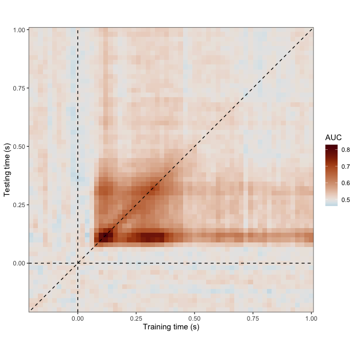
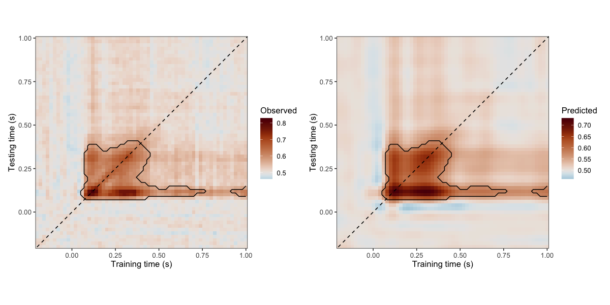

# Bayesian modelling of cross-temporal decoding generalisation

Cross-temporal generalisation analysis investigates how neural representations evolve over time by training a classifier at one time point and evaluating its performance at other time points. This produces a two-dimensional matrix in which each cell represents decoding performance for a particular combination of training and testing times.

Decoding performance along the diagonal reflects classification at matching training and testing times, whereas off-diagonal generalisation provides information about how decoding patterns transfer across time. Broad generalisation patterns may suggest temporally persistent or overlapping discriminative information, while more restricted patterns may indicate time-specific changes.

In this vignette, we demonstrate how to analyse cross-temporal decoding matrices using Bayesian generalised additive multilevel models (BGAMMs), as introduced in Nalborczyk & Bürkner (2025, Appendix A; DOI: 10.1101/2025.08.29.672336). We illustrate how to model decoding performance as a smooth function of training and testing times, account for repeated observations across participants, and identify regions showing posterior evidence for above-chance decoding.

## Importing and visualising the data

We use the `timegen_data` dataset included in `neurogam`, which contains cross-temporal decoding performance measured using the area under the receiver operating characteristic curve (AUC). Each observation corresponds to decoding performance at a particular combination of training and testing times. For binary classification, an AUC of 0.5 corresponds to chance-level discrimination, whereas higher values indicate better-than-chance classification.

We first average AUC values across participants at each training–testing time combination to visualise the overall temporal generalisation pattern. The diagonal indicates matching training and testing times, while the dashed horizontal and vertical lines indicate stimulus onset (0 s). This visualisation is descriptive: the statistical model introduced below retains the participant-level observations rather than fitting the group-averaged matrix alone.


``` r
library(neurogam)
library(ggplot2)
library(scico)
library(dplyr)

# retrieving some EEG data
data(timegen_data)
head(timegen_data)
#>   train_time test_time       auc participant
#> 1       -0.2      -0.2 0.5639503           1
#> 2       -0.2      -0.2 0.5967508           2
#> 3       -0.2      -0.2 0.4648438           3
#> 4       -0.2      -0.2 0.4935377           4
#> 5       -0.2      -0.2 0.5228509           5
#> 6       -0.2      -0.2 0.4771995           6

# plotting the cross-temporal generalisation matrix
timegen_data |>
    summarise(auc = mean(auc), .by = c(train_time, test_time) ) |>
    ggplot(aes(x = train_time, y = test_time, fill = auc) ) +
    geom_tile() +
    geom_vline(xintercept = 0, linetype = 2, linewidth = 0.5) +
    geom_hline(yintercept = 0, linetype = 2, linewidth = 0.5) +
    geom_abline(slope = 1, intercept = 0, linetype = 2, linewidth = 0.5) +
    scale_x_continuous(expand = c(0, 0) ) +
    scale_y_continuous(expand = c(0, 0) ) +
    coord_fixed() +
    theme_bw() +
    scico::scale_fill_scico(palette = "vik", midpoint = 0.5, name = "AUC") +
    labs(x = "Training time (s)", y = "Testing time (s)")
```



## Fitting a two-dimensional BGAMM

To model cross-temporal decoding performance, we use a BGAMM with a two-dimensional tensor-product smooth over training and testing times. The smooth term `t2(train_time, test_time)` allows the model to capture potentially nonlinear variation in decoding accuracy across the temporal generalisation matrix. We additionally include a participant-specific random intercept to account for between-participant differences in overall decoding performance, without introducing participant-specific smooths.

Compared with one-dimensional temporal models, two-dimensional BGAMMs can be considerably more computationally demanding because they estimate a smooth surface rather than a single time course. We therefore recommend beginning with a relatively simple model, using moderate basis dimensions (`k`), before considering more complex random-effects structures.

The example below uses two MCMC chains with within-chain parallelisation, implemented through `brms` and the `cmdstanr` backend. Computational requirements depend on the number of observations, basis dimensions, model structure, and available hardware.

For a broader introduction to generalised additive models and tensor-product smooths, see [Pedersen et al. (2019)](https://pmc.ncbi.nlm.nih.gov/articles/PMC6542350/).


``` r
library(brms)

# fitting a BGAMM with two temporal dimensions
timegen_gam <- brm(
    formula = auc ~ t2(train_time, test_time, bs = "tp", k = 25) + (1 | participant),
    data = timegen_data,
    warmup = 1000,
    iter = 3000,
    chains = 2,
    cores = 2,
    backend = "cmdstanr",
    threads = threading(threads = 4),
    stan_model_args = list(stanc_options = list("O1") )
    )
```

## Identifying regions of above-chance decoding

After fitting the BGAMM, we can use `testing_through_time()` to summarise posterior predictions across the training–testing time grid and identify contiguous regions showing evidence for above-chance decoding. Rather than relying exclusively on the theoretical chance level of AUC = 0.5, we can define a small region of practical equivalence (ROPE) around chance to account for minor deviations in decoding performance.

For this example, we derive an empirical threshold from the pre-stimulus portion of the decoding matrix, restricting the calculation to cells where both training and testing times precede stimulus onset. We calculate the 95th percentile of baseline AUC values and use its excess above 0.5 as the ROPE half-width, provided that this excess is positive.

With `odds_mode = "directional_rope"`, positive evidence is quantified using the posterior odds that decoding performance exceeds the upper ROPE boundary. We use a posterior-odds threshold of 10 and restrict cluster detection to the positive direction (`threshold_type = "above"`). The example below illustrates the complete analysis. Because fitting this model can require several hours, the vignette uses a previously fitted model to produce the displayed results.


``` r
# we compute the smallest effect size of interest (SESOI) as the baseline
# (i.e., before stimulus onset) upper 95% quantile of AUC values
baseline_upper_quantile <- timegen_data %>%
    filter(train_time < 0 & test_time < 0) %>%
    summarise(quantile(x = auc, probs = 0.95) ) %>%
    pull()

# fitting the BGAMM to identify clusters
results <- testing_through_time(
    # cross-temporal generalisation data
    data = timegen_data,
    # participant column
    participant_id = "participant",
    # AUC column
    outcome_id = "auc",
    # testing against chance level
    predictor_id = NA,
    # defining training and testing times
    time_id = c("train_time", "test_time"),
    # basis dimension
    kvalue = 25,
    # only includes a per-participant varying intercept (no varying smooth)
    multilevel = "summary",
    use_se = FALSE,
    varying_smooth = FALSE,
    # defining chance level for AUC values
    # chance_level = 0.5,
    # defining chance level + SESOI (upper AUC values during baseline)
    chance_level = baseline_upper_quantile,
    # threshold on posterior odds
    threshold = 10,
    # testing whether AUC is above chance
    threshold_type = "above",
    # number of warmup iterations
    warmup = 1000,
    # total number of iterations (per chain)
    iter = 3000,
    # number of MCMCs
    chains = 2,
    # number of parallel cores
    cores = 2,
    # using with-chain parallelisation (needs 2x4 parallel cores)
    threads = brms::threading(threads = 4),
    # increasing max_treedepth
    stan_control = list(max_treedepth = 15),
    backend = "cmdstanr",
    file = "cache/timegen_results"
    )
```


## Summarising and visualising the results

The returned object can be inspected using the dedicated `print()`, `summary()`, and `plot()` methods.

The printed results provide information about the detected clusters, whereas the graphical representation allows us to examine their distribution across training and testing times in relation to the estimated decoding surface. These clusters identify connected regions in which the posterior evidence exceeds the specified threshold. Together, these methods provide a framework for characterising both the estimated temporal generalisation pattern and the strength of posterior evidence for decoding performance beyond a specified reference level.


``` r
# print a summary table
print(results)
#> 
#> ==== Time-resolved GAM results ================================
#>   Analysis: Temporal generalization (2D)
#>   Model coordinates: time1, time2
#>   Cluster coordinates: time1, time2
#>   Contrast: one_sample
#>   Posterior odds mode: directional_rope
#>   Odds threshold: 10
#>   Clusters found: 2
#> 
#> Cluster table:
#> 
#>      sign id n_points time1_min time1_max time2_min time2_max
#>  positive  1      314      0.06      0.76      0.08      0.40
#>  positive  2        9      0.92      1.00      0.10      0.14
#> =================================================================

# for available colour palettes, see scico::scico_palette_show()
plot(
    x = results,
    palette = "vik", midpoint = 0.5,
    axes_labels = c("Training time (s)", "Testing time (s)")
    )
```


